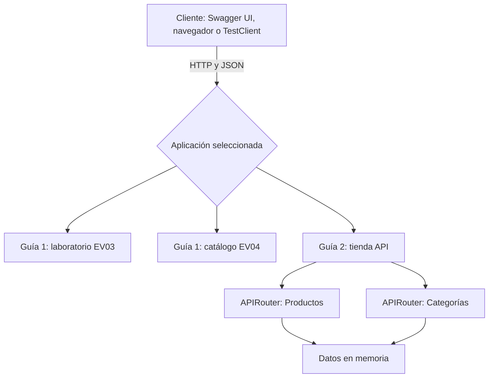

<div align="center">

# FastAPI · SENA | Guías de aprendizaje

### Desarrollo progresivo de API REST con Python

[](https://www.python.org/)
[](https://fastapi.tiangolo.com/)
[](https://www.uvicorn.org/)
[](https://github.com/JuanEstebanLT/fastapi-sena)

**SENA · Análisis y Desarrollo de Software (ADSO)**  
**Instructor:** Mateo Arroyave  
**Equipo:** Juan Esteban Lezcano Tejada · Mariana Suárez · Emanuel Villa

</div>

---

## Descripción

Repositorio académico único para las guías progresivas del curso **FastAPI**. Cada guía se encuentra aislada dentro de su carpeta y define su propia aplicación; esto permite ejecutarlas, probarlas y documentarlas de manera independiente, sin mezclar los endpoints de diferentes actividades.

Las prácticas son **proyectos de aprendizaje**: no cuentan con despliegue público ni persistencia en una base de datos. Los datos de ejemplo se mantienen en memoria mientras está activo el servidor.

## Índice

- [Guías disponibles](#guías-disponibles)
- [Arquitectura](#arquitectura)
- [Estructura de carpetas](#estructura-de-carpetas)
- [Instalación](#instalación)
- [Ejecutar cada guía](#ejecutar-cada-guía)
- [Pruebas automatizadas](#pruebas-automatizadas)
- [Evidencias y sustentación](#evidencias-y-sustentación)
- [Estado de las entregas](#estado-de-las-entregas)
- [Equipo y referencias](#equipo-y-referencias)

## Guías disponibles

| Guía | Contenido | Aplicaciones / endpoints | Evidencias |
| --- | --- | --- | --- |
| [**Guía 1**](guia_01/README.md) | Fundamentos de API, HTTP, consultas GET y Swagger UI | Laboratorio: 6 rutas GET; catálogo: 5 rutas GET | [PDF](guia_01/evidencias/Guia_FastAPI_Final.pdf) · [Video](https://youtu.be/39X68AKH1gg) |
| [**Guía 2**](guia_02/README.md) | CRUD, validación Pydantic y módulos APIRouter | Tienda: 5 rutas de productos + 5 de categorías y ruta de inicio | Capturas e informe pendientes |

> La **Guía 1** tiene informe y sustentación publicados. En la **Guía 2** el código y las pruebas automatizadas están preparados; todavía faltan las capturas de Swagger UI, las evidencias teóricas y la sustentación, si la exige el instructor.

## Arquitectura

Cada práctica expone una instancia independiente de FastAPI. Se inicia **una aplicación por vez** en el puerto 8000, o se asignan puertos distintos si se necesitan simultáneamente.



La Guía 1 conserva el laboratorio y catálogo separados. En la Guía 2, `main.py` incorpora los routers de productos y categorías, y Pydantic valida los cuerpos JSON de las peticiones `POST` y `PUT`.

## Estructura de carpetas

```text
fastapi-sena/
├── guia_01/
│   ├── laboratorio_ev03/
│   │   └── main.py
│   ├── catalogo_ev04/
│   │   └── main.py
│   ├── evidencias/
│   │   ├── Guia_FastAPI_Final.pdf
│   │   └── Guia1 - FastAPI.mp4
│   ├── main.py
│   └── README.md
├── guia_02/
│   ├── tienda_api/
│   │   ├── main.py
│   │   └── routers/
│   │       ├── __init__.py
│   │       ├── productos.py
│   │       └── categorias.py
│   ├── evidencias/
│   │   └── README.md
│   └── README.md
├── evidencias/                 # Copias de compatibilidad de Guía 1
├── tests/
│   ├── test_guia_01.py
│   └── test_guia_02.py
├── requirements.txt
├── requirements-dev.txt
├── .gitignore
└── README.md
```

La carpeta `evidencias/` de la raíz se conserva **solo para no romper enlaces previos** al PDF y video de la Guía 1. El directorio organizado por guía es `guia_01/evidencias/`.

## Instalación

Desde Windows (CMD o PowerShell):

```powershell
git clone https://github.com/JuanEstebanLT/fastapi-sena.git
cd fastapi-sena
py -m venv venv
```

**Activar entorno virtual en CMD:**

```bat
venv\Scripts\activate.bat
```

**O en PowerShell:**

```powershell
.\venv\Scripts\Activate.ps1
```

**Instalar dependencias de ejecución:**

```powershell
python -m pip install -r requirements.txt
```

Si se desean ejecutar las pruebas automatizadas, instalar adicionalmente las dependencias de desarrollo:

```powershell
python -m pip install -r requirements-dev.txt
```

> Todos los comandos siguientes se ejecutan **desde la raíz del repositorio**, no desde las carpetas de las guías.

## Ejecutar cada guía

### Guía 1 — Laboratorio EV03

```powershell
python -m uvicorn guia_01.laboratorio_ev03.main:app --reload
```

**Seis endpoints GET:** `/`, `/productos/{producto_id}`, `/buscar`, `/categorias/{categoria_id}`, `/saludo/{nombre}` y `/filtrar`.

### Guía 1 — Catálogo EV04

```powershell
python -m uvicorn guia_01.catalogo_ev04.main:app --reload
```

**Cinco endpoints GET:** `/`, `/productos`, `/productos/{producto_id}`, `/categorias` y `/buscar`.

### Guía 2 — CRUD de productos y categorías

```powershell
python -m uvicorn guia_02.tienda_api.main:app --reload
```

La Guía 2 ofrece **cinco rutas de productos** y **cinco de categorías**, agrupadas en Swagger UI mediante `APIRouter`, además del endpoint de bienvenida `/`.

**Para todas las prácticas:**

- Swagger UI: <http://127.0.0.1:8000/docs>
- ReDoc: <http://127.0.0.1:8000/redoc>
- OpenAPI: <http://127.0.0.1:8000/openapi.json>

Detener la aplicación actual con **Ctrl + C** antes de iniciar otra en el mismo puerto. La documentación muestra **solo los endpoints de la aplicación que esté en ejecución**.

## Pruebas automatizadas

Desde la raíz del repositorio y con `requirements-dev.txt` instalado:

**Solo Guía 1:**

```powershell
python -m pytest tests/test_guia_01.py -q
```

**Solo Guía 2:**

```powershell
python -m pytest tests/test_guia_02.py -q
```

**Todas las guías:**

```powershell
python -m pytest tests -q
```

Las pruebas usan `TestClient` y verifican respuestas correctas, CRUD y errores HTTP `404` y `422`. Estas pruebas automatizadas **no reemplazan las capturas de `/docs`** que solicita el instructor para la Guía 2.

## Evidencias y sustentación

- **Guía 1:** [Informe final PDF](guia_01/evidencias/Guia_FastAPI_Final.pdf), [archivo MP4](guia_01/evidencias/Guia1%20-%20FastAPI.mp4) y [video publicado en YouTube](https://youtu.be/39X68AKH1gg).
- **Guía 2:** [Requisitos de evidencias pendientes](guia_02/evidencias/README.md). La guía solicita capturas de CRUD de categorías, incluidos casos `404` y `422`, junto con README y enlace al repositorio.

## Estado de las entregas

| Guía | Código | Pruebas | Informe y evidencias | Sustentación |
| --- | --- | --- | --- | --- |
| 1 | Implementado | Documentadas y automatizadas | Publicado | [Video disponible](https://youtu.be/39X68AKH1gg) |
| 2 | Implementado en la estructura modular | Automatizadas localmente; capturas pendientes | Pendiente | Por definir con el instructor |

## Equipo y referencias

**Integrantes:** Juan Esteban Lezcano Tejada, Mariana Suárez y Emanuel Villa.  
**Instructor:** Mateo Arroyave.  
**Institución:** Servicio Nacional de Aprendizaje (SENA), ADSO.

Documentación: [FastAPI](https://fastapi.tiangolo.com/), [APIRouter](https://fastapi.tiangolo.com/tutorial/bigger-applications/), [Pydantic](https://docs.pydantic.dev/latest/concepts/models/) y [Uvicorn](https://www.uvicorn.org/).

